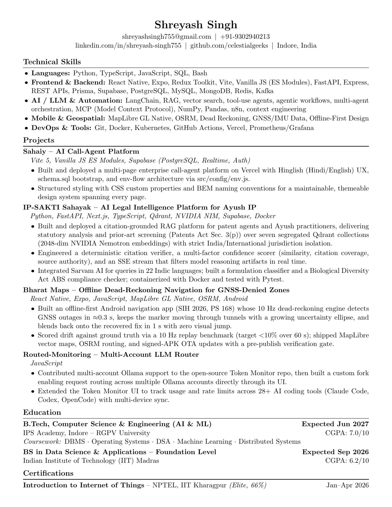

# 📄 Master Resume & Version Catalog

<div align="center">


<br/>

**A structured, automated repository for maintaining the canonical Master Resume, date-stamped customized versions, and instant visual previews.**

[📥 Master PDF](master/resume.pdf) • [📝 Master LaTeX](master/resume.tex) • [📑 Full Version Index (INDEX.md)](INDEX.md) • [🚀 How to Archive](#-how-to-drop--archive-versions)

</div>

---

## 🌟 Master Resume Showcase

<div align="center">
  <p><b>Canonical Living Master Resume</b></p>
  <a href="master/resume.pdf">
    
  </a>
  <p><i>Click the image above to open the full master PDF.</i></p>
</div>

> 💡 **Master Profile Highlights & Architecture**:  
> Canonical 1-Page Master Resume v4 (Updated Sep 24, 2026). Skills audited and categorized into 6 ATS-optimized domains: Languages (Python, TypeScript, JS, SQL, HTML5, CSS3, Bash), Frontend (React, Next.js, React Native, Expo, Vite, Tailwind CSS), Backend (FastAPI, REST APIs, SSE, Pydantic, Supabase, PostgreSQL), AI/LLM (RAG, Vector Search, Qdrant, Semantic Embeddings, NVIDIA NIM, Ollama, Prompt Engineering, Sarvam AI), Mobile & Geospatial (Android, MapLibre GL, OSRM, Dead Reckoning, GNSS/IMU), and DevOps/Testing (Git, Docker, Vercel, Render, Pytest). Synchronized project tech-stacks (Sahaiy, IP-SAKTI Sahayak, Bharat Maps, Routed-Monitoring) and improved typesetting with hyphenation suppression.

<br/>

### 📊 Repository Summary & Factors

| Metric | Status | Details |
| :--- | :--- | :--- |
| **Master Resume** | `✅ Synced` | `master/resume.tex` & `master/resume.pdf` |
| **Last Master Update** | `2026-09-24` | Source of truth for all role-specific derivatives |
| **Total Tailored Versions** | `4` | Tracked in [registry.json](registry.json) |
| **Latest Tailored Role** | `v3_karamtara_get` | Cataloged on `2026-10-16` |
| **Compiler** | `Tectonic` | Standalone modern TeX/LaTeX engine |

---

## 🕒 Recent Tailored Versions (Latest 5)

| Date | Target / Company | Key Changes Made | Files |
| :--- | :--- | :--- | :--- |
| `2026-10-16` | **v3_karamtara_get** | Karamtara Engineering GET (IPSA closed drive). v3 revised to owner instruction: master v4 layout kept field-for-field (Contact > Technical Skills > Projects > Education > Certifications, same 4 projects in same order); only content optimised - plant/records/verification vocabulary in every bullet, offline field-condition framing on Bharat Maps, auditability framing on IP-SAKTI, SQL and PostgreSQL promoted in Languages/Backend, GNSS-IMU sensor data leading Mobile & Geospatial, CGPA 7.12/10 (71.2%) with no active backlogs, NPTEL IoT cert with 4 credits. One page, no overflow. | [LaTeX](versions/2026-10-16_v3_karamtara_get_v2/resume.tex) · [PDF](versions/2026-10-16_v3_karamtara_get_v2/resume.pdf) |
| `2026-10-16` | **v3_karamtara_get** | Karamtara Engineering GET (IPSA closed campus drive, B.Tech 2027). Material re-target: education and certifications promoted above skills (60% aggregate is the knockout), new Target block naming the three plants and June 2027 availability, project set reordered with Sentinel restored and Routed-Monitoring/Poymarket cut, bullets rewritten as problem-action-outcome-trainee-responsibility, employer vocabulary mirrored (records, dashboards, downtime, ERP/BOM traceability, IoT sensors), jargon wall removed, bio-data fields and CGPA 7.12/71.2% printed. Master v4 typesetting unchanged; one page. | [LaTeX](versions/2026-10-16_v3_karamtara_get/resume.tex) · [PDF](versions/2026-10-16_v3_karamtara_get/resume.pdf) |
| `2026-09-24` | **v2_ayush_legal_rag** | Updated resume version (Sep 24, 2026). Replaced Sentinel with IP-SAKTI Sahayak (AI Legal Intelligence Platform for Ayush IP / SIH 2026 solo project) featuring citation-grounded RAG with 2048-dim NVIDIA Nemotron embeddings across 7 Qdrant collections, Patents Act Sec 3(p) prior-art analysis, Sarvam AI 22 Indic languages, and Biological Diversity Act ABS compliance. | [LaTeX](versions/2026-09-24_v2_ayush_legal_rag/resume.tex) · [PDF](versions/2026-09-24_v2_ayush_legal_rag/resume.pdf) |
| `2026-08-25` | **v1_aiml_fintech** | First cataloged version (Aug 25, 2026). AI & Fintech focus highlighting Sentinel (event-driven AML fraud detection via FastAPI, Kafka, Neo4j, Milvus), Polymarket-Algo (Binance latency arbitrage with LightGBM & K-Means), Sahaiy (Hinglish AI call-agent on Vite & Supabase), and Routed-Monitoring (multi-account LLM router across 28+ AI tools). | [LaTeX](versions/2026-08-25_v1_aiml_fintech/resume.tex) · [PDF](versions/2026-08-25_v1_aiml_fintech/resume.pdf) |

👉 **[View all 4 archived versions in the complete index (INDEX.md)](INDEX.md)**

---

## 🚀 How to Drop & Archive Versions

### 1. Ingesting New Master Resume Files
When you want to update your primary base resume:
```bash
# Option A: Place resume.tex and resume.pdf into inbox/ or master/, then run:
./archive.sh --master

# Option B: Pass explicit paths
./archive.sh --master --tex /path/to/my_resume.tex --pdf /path/to/my_resume.pdf
```
*This automatically renders the high-resolution preview image and updates the README showcase.*

### 2. Archiving a Tailored Version (Date-wise)
Whenever you customize your resume for a specific job application, role, or company:
```bash
# Step 1: Drop the .tex and .pdf into the inbox/ folder
# Step 2: Run the intake assistant:
./archive.sh
```
The interactive assistant will ask:
- **Target / Tag**: (e.g. `Google_SWE`, `Apple_CoreML`, `JaneStreet_Quant`)
- **Description of changes**: (e.g. `Tailored experience bullets to distributed systems and low-latency C++`)

Or run with direct flags in one command:
```bash
./archive.sh --tag "Google_SWE" --desc "Focused on backend infrastructure and caching optimizations"
```

The system will:
1. Move the files to `versions/YYYY-MM-DD_<tag>/`
2. Create `metadata.json` with the changelog
3. Generate a thumbnail preview
4. Update `registry.json`, `INDEX.md`, and `README.md`
5. Create a clean Git commit and push to your private GitHub repo!

---

## 🛠 Directory Layout

```
Resume/
├── master/                      # Canonical living master resume
│   ├── resume.tex
│   └── resume.pdf
├── versions/                    # Date-wise customized versions
│   └── YYYY-MM-DD_<tag>/
│       ├── resume.tex
│       ├── resume.pdf
│       ├── preview.png
│       └── metadata.json
├── inbox/                       # Quick-drop folder for incoming files
├── assets/                      # Generated previews & badges
│   ├── master_preview.png
│   └── master_placeholder.svg
├── scripts/                     # Automation & indexing tools
├── archive.sh                   # Main CLI entrypoint
├── registry.json                # Single machine-readable source of truth
├── INDEX.md                     # Full chronological index table
└── README.md                    # Showcase & documentation
```

---

## ⚡ LaTeX Compilation with Tectonic
To compile any `.tex` file directly to `.pdf`:
```bash
tectonic master/resume.tex
# Or compile a version:
tectonic versions/2026-09-24_google-swe/resume.tex
```
